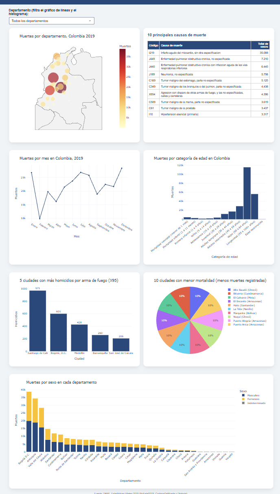
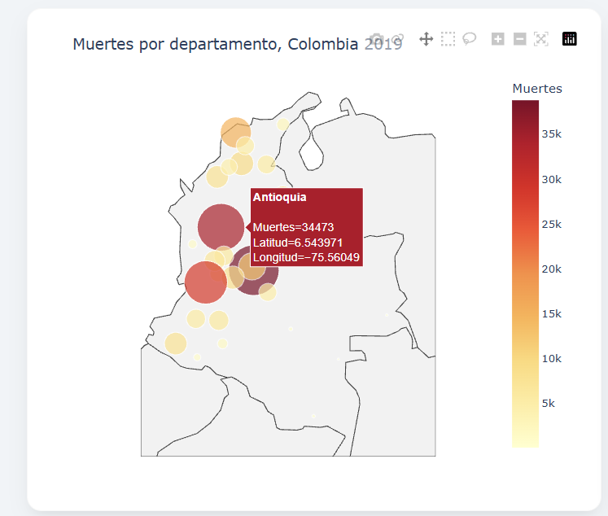
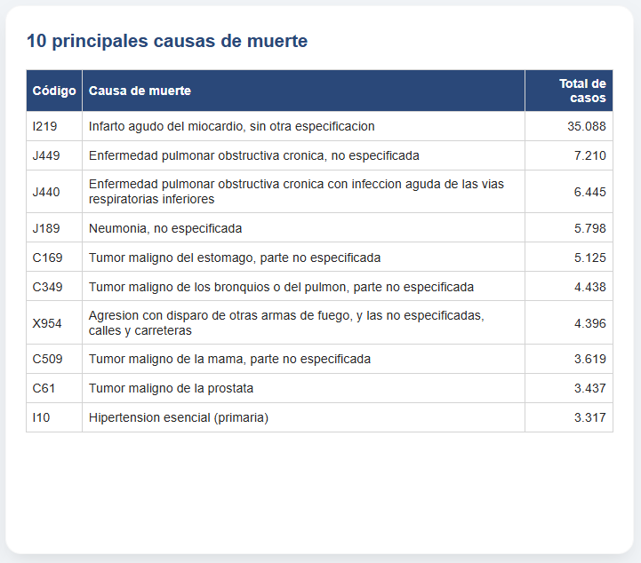
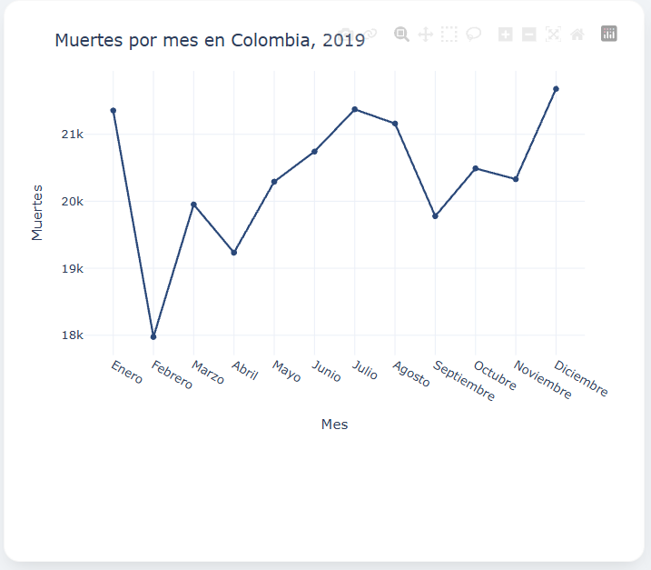
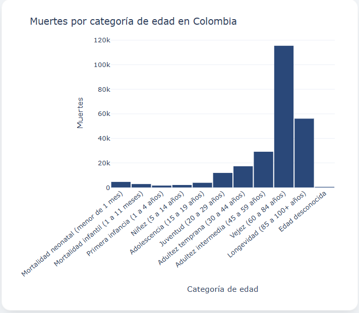
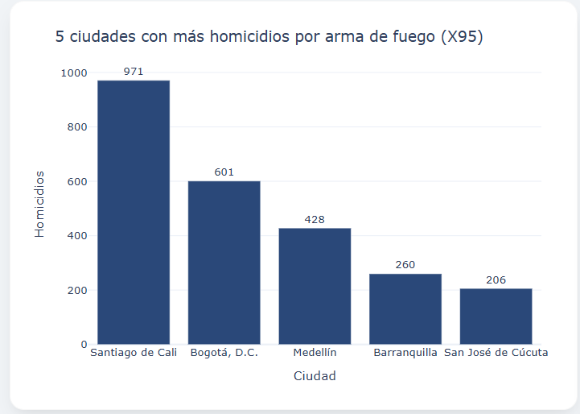
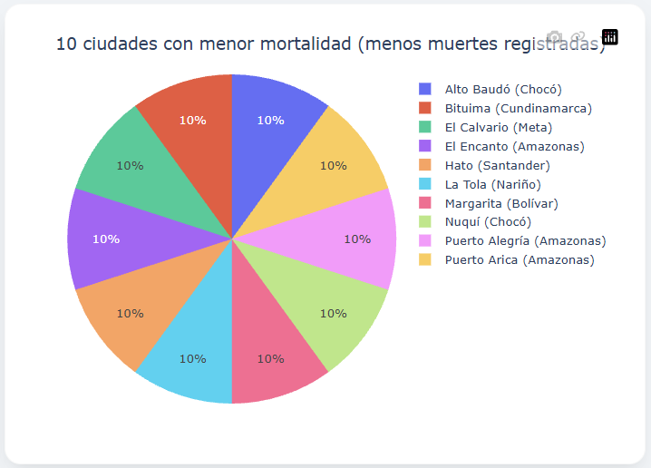
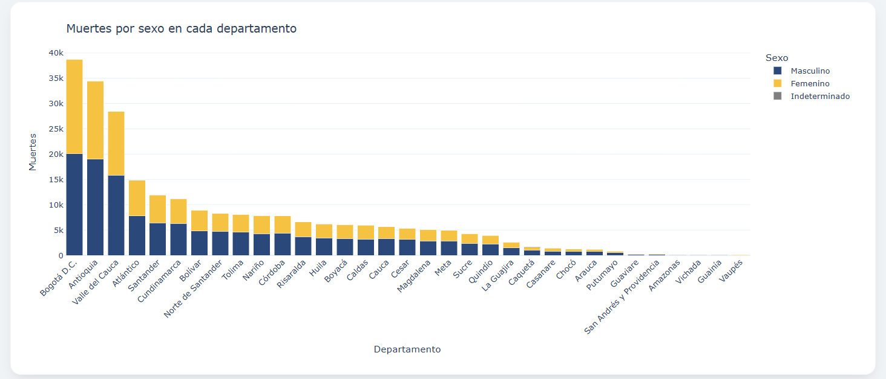

# Mortalidad en Colombia, 2019 – Aplicación web con Dash

## Introducción del proyecto

Aplicación web interactiva hecha en **Python** con **Dash** y **Plotly** que permite explorar las muertes no fetales registradas en Colombia durante 2019. Reúne en una sola página un mapa, una tabla y cinco gráficos que muestran cuántas personas murieron, cuándo, dónde, de qué y a qué edad. Los datos son de las *Estadísticas Vitales 2019* del DANE.

## Objetivo

Identificar patrones demográficos y regionales de la mortalidad en Colombia en 2019, y presentarlos en un tablero fácil de entender para personas que no son técnicas. Las preguntas que responde son:

- ¿En qué departamentos se concentran las muertes?
- ¿Cómo varían las muertes a lo largo del año?
- ¿Cuáles son las ciudades con más homicidios con arma de fuego y las que menos muertes registran?
- ¿Cuáles son las 10 causas de muerte más frecuentes?
- ¿Hay diferencias entre hombres y mujeres en cada departamento?
- ¿En qué etapa de la vida ocurren más muertes?

## Estructura del proyecto

```
mortalidad_colombia_2019/
├── app.py                 # Aplicación Dash: diseño de la página y callback del filtro
├── datos.py               # Funciones que cargan los datos y calculan la tabla de cada gráfico
├── graficos.py            # Funciones que crean cada gráfico con Plotly Express
├── preparar_datos.py      # Convierte los Excel del DANE en CSV (se ejecuta una sola vez)
├── requirements.txt       # Librerías necesarias
├── assets/
│   └── estilos.css        # Colores y diseño de la página (Dash lo carga solo)
├── data/
│   ├── muertes_2019.csv   # 244.355 registros de mortalidad (solo las columnas usadas)
│   ├── causas_muerte.csv  # Código CIE-10 → nombre de la causa
│   └── divipola.csv       # Departamentos, municipios y coordenadas
├── datos_originales/      # Aquí se copian los Excel del DANE (solo si se quiere regenerar data/)
└── docs/capturas/         # Capturas de pantalla usadas en este README
```

**Cómo está organizado el código:** `app.py` solo arma la página; `datos.py` calcula y `graficos.py` dibuja. Cada función hace una sola cosa y tiene una descripción corta al inicio, de modo que se puede leer de arriba hacia abajo.

## Requisitos

- Python 3.10 o superior
- Librerías (están en `requirements.txt`):

| Librería | Versión mínima | Para qué se usa |
|----------|----------------|-----------------|
| dash     | 2.18           | Aplicación web, menú desplegable y tabla |
| plotly   | 5.24           | Gráficos interactivos |
| pandas   | 2.2            | Leer los CSV y calcular los totales |
| gunicorn | 22.0           | Servidor de producción para el despliegue |

La aplicación se probó con las versiones mínimas indicadas y con las más recientes.

## Software

- **Python**: lenguaje de programación.
- **Dash**: framework para crear la aplicación web.
- **Plotly Express**: creación de los gráficos.
- **Pandas**: manejo y suma de datos.
- **Gunicorn**: servidor web para producción.
- **Visual Studio Code**, **Git** y **GitHub**: edición del código y control de versiones.
- **Render**: plataforma (PaaS) donde se despliega la aplicación.

## Instalación

1. Clonar el repositorio y entrar a la carpeta:

   ```bash
   git clone https://github.com/USUARIO/NOMBRE-DEL-REPOSITORIO.git
   cd NOMBRE-DEL-REPOSITORIO
   ```

2. Crear y activar un entorno virtual:

   ```bash
   # Windows
   py -m venv venv
   venv\Scripts\activate

   # macOS / Linux
   python3 -m venv venv
   source venv/bin/activate
   ```

3. Instalar las librerías:

   ```bash
   pip install -r requirements.txt
   ```

4. Ejecutar la aplicación:

   ```bash
   python app.py
   ```

5. Abrir en el navegador: <http://127.0.0.1:8050>

Los archivos de la carpeta `data/` ya vienen listos, así que no hace falta nada más.

### (Opcional) Regenerar los CSV desde los Excel del DANE

Solo si se quiere repetir la conversión. Copiar los tres Excel en `datos_originales/` y ejecutar:

```bash
pip install openpyxl
python preparar_datos.py
```

Se hace con CSV porque el Excel de mortalidad pesa 19 MB, tarda más de un minuto en leerse y consume mucha memoria; con los CSV la aplicación arranca en un par de segundos y usa unos 140 MB, lo que cabe en el plan gratuito de Render (512 MB).

## Despliegue (en Render)

1. Subir el proyecto a un repositorio de GitHub (la carpeta `data/` debe ir incluida):

   ```bash
   git init
   git add .
   git commit -m "Aplicación de mortalidad en Colombia 2019"
   git branch -M main
   git remote add origin https://github.com/USUARIO/NOMBRE-DEL-REPOSITORIO.git
   git push -u origin main
   ```

2. Entrar a <https://render.com> y crear una cuenta (se puede usar la de GitHub).
3. Pulsar **New → Web Service** y conectar el repositorio.
4. Completar el formulario:
   - **Name:** el nombre de la aplicación (por ejemplo `mortalidad-colombia-2019`).
   - **Runtime / Environment:** Python 3.
   - **Build Command:** `pip install -r requirements.txt`
   - **Start Command:** `gunicorn app:server`
   - **Instance Type:** Free.
5. Pulsar **Create Web Service** y esperar unos minutos mientras Render instala las librerías.
6. Cuando termine, Render muestra la dirección pública (algo como `https://mortalidad-colombia-2019.onrender.com`).

**Nota:** el comando `gunicorn app:server` funciona porque en `app.py` existe la línea `server = app.server`. En el plan gratuito, la primera visita después de un rato sin uso puede tardar cerca de un minuto en cargar.

## Visualizaciones con explicaciones de los resultados

La página tiene un menú desplegable **Departamento** que actualiza el gráfico de líneas y el histograma. Todos los gráficos son interactivos: al pasar el cursor se ven los valores, y se puede ampliar, mover y descargar cada gráfico con la barra de herramientas de Plotly.



En 2019 se registraron **244.355** muertes no fetales en el país.

### 1. Mapa: muertes por departamento



Cada burbuja es un departamento; su tamaño y color indican el total de muertes. **Bogotá D.C. (38.760), Antioquia (34.473) y Valle del Cauca (28.443)** suman el 41,6 % de todas las muertes del país. Los departamentos con menos muertes son Vaupés (87), Guainía (115) y Vichada (188). Esto refleja sobre todo el tamaño de la población de cada departamento, porque se muestran totales y no tasas.

### 2. Tabla: 10 principales causas de muerte



La primera causa es el **infarto agudo del miocardio (I219), con 35.088 muertes**, el 14,4 % de todas las muertes y casi cinco veces más que la segunda. La enfermedad pulmonar obstructiva crónica aparece dos veces (J449 con 7.210 y J440 con 6.445, en total 13.655). También figuran la neumonía (5.798), cuatro tipos de cáncer (estómago, pulmón, mama y próstata), la hipertensión esencial (3.317) y los homicidios con arma de fuego en calles y carreteras (X954, 4.396, en el séptimo lugar). Las 10 causas juntas explican el 32,3 % de las muertes.

### 3. Gráfico de líneas: muertes por mes



Las muertes se mantienen estables durante el año, con un promedio de unas 20.400 por mes. Los meses con más muertes son **diciembre (21.678), julio (21.372) y enero (21.354)**, y el de menos es **febrero (17.974)**, que además es el mes más corto. La diferencia entre el mes más alto y el más bajo es de solo 21 %, es decir, no hay una temporada marcada. Al elegir un departamento se puede comprobar si su comportamiento es distinto.

### 4. Histograma: muertes por etapa de la vida



Los valores de `GRUPO_EDAD1` se agruparon en las 11 categorías de la tabla de la actividad. **El 70,2 % de las muertes ocurre a partir de los 60 años** (Vejez: 115.453, el 47,2 %; Longevidad: 56.061, el 22,9 %). Le sigue la adultez intermedia (45 a 59 años) con 29.105. Las muertes de menores de 1 año suman 7.291 (4.520 neonatales y 2.771 infantiles), más que las de la primera infancia (1.518) y la niñez (1.993) juntas. Hay 23 registros de edad desconocida.

### 5. Gráfico de barras: 5 ciudades con más homicidios con arma de fuego



Se cuentan las muertes con código CIE-10 **X95** (agresión con disparo de otras armas de fuego y las no especificadas). Las ciudades con más casos son **Cali (971), Bogotá (601), Medellín (428), Barranquilla (260) y Cúcuta (206)**. Juntas reúnen el 26,6 % de los 9.273 casos del país. Son cifras absolutas: las ciudades más grandes tienden a tener más casos, por lo que no equivalen a una tasa por habitante.

### 6. Gráfico circular: 10 ciudades con menor mortalidad



Se muestran las ciudades (municipios) con menos muertes registradas en 2019. **13 municipios empatan con una sola muerte**, así que el gráfico muestra 10 de ellos, elegidos en orden alfabético: Alto Baudó, Bituima, El Calvario, El Encanto, Hato, La Tola, Margarita, Nuquí, Puerto Alegría y Puerto Arica. Por eso todas las porciones son iguales. Son municipios pequeños y apartados (varios en Amazonas y Chocó).

### 7. Barras apiladas: muertes por sexo en cada departamento



Murieron **134.573 hombres (55,1 %) y 109.689 mujeres (44,9 %)**, y 93 casos de sexo indeterminado. En los 33 departamentos hay más muertes de hombres que de mujeres. La diferencia es menor en Bogotá D.C. (20.058 hombres y 18.679 mujeres) y mayor en departamentos pequeños como Guaviare (185 y 55), Guainía (78 y 37) y Amazonas (125 y 65), donde mueren casi el doble o más hombres que mujeres.

## Decisiones y supuestos

- **Mapa:** se usa un mapa de burbujas con las coordenadas de la hoja *Hoja3* de Divipola. La posición de cada departamento es el promedio de las coordenadas de sus municipios.
- **Homicidios:** se cuentan los registros cuyo `COD_MUERTE` empieza por `X95`, como pide la actividad.
- **Menor mortalidad:** los archivos no incluyen la población de cada municipio, así que no se puede calcular una tasa. Se usa el menor número de muertes registradas y solo se consideran los municipios con al menos una muerte (con cero muertes no habría nada que graficar).
- **Causas de muerte:** se agrupan por el código tal como viene en los datos (3 o 4 caracteres) y su nombre se toma del catálogo CIE-10.
- **Ciudades:** se usan los municipios de la tabla Divipola.

## Fuentes de datos

- DANE, Estadísticas Vitales 2019: *NoFetal2019* (microdatos de mortalidad), *CodigosDeMuerte* (catálogo CIE-10) y *Divipola* (División Político-Administrativa de Colombia).

## 📌 Autor y Afiliación

* **Autor:** Brayan Alberto Castellanos Vargas  
* **Institución:** Universidad de La Salle  
* **Programa:** Maestría en Inteligencia Artificial *(1er Semestre)*  
* **Asignatura:** Aplicaciones I  
* **Año:** 2026